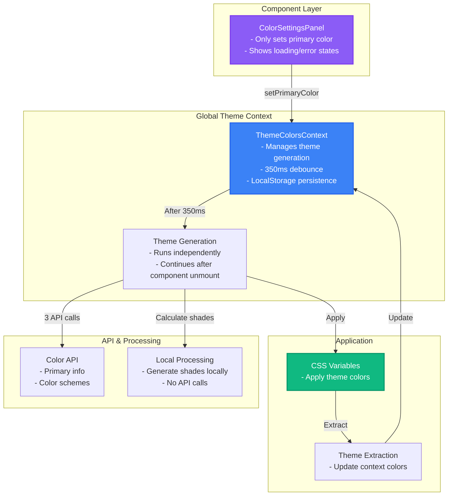

## Dimitri's Portfolio

This repository contains the source code for my personal portfolio, designed to showcase my skills in full-stack engineering, data science, and application architecture. The site is not just a static page, but a fully interactive application with several advanced features under the hood.

### Core Technologies

- **Framework**: Next.js 16 (React 19)
- **Language**: TypeScript
- **Styling**: Tailwind CSS 4, HeroUI
- **3D Graphics**: Three.js / react-three-fiber
- **Deployment**: Vercel
- **Infrastructure**: Pulumi on AWS (AppSync Events, SES, DynamoDB), Vercel and Cloudflare DNS

---

### Key Engineering Achievements

#### 1. Adaptive Performance System

The application dynamically adjusts its performance based on the user's hardware.

- **Hardware-Aware Context**: A custom React context (`HardwarePerformanceContext`) detects CPU cores, RAM, and GPU capabilities on page load.
- **Dynamic Feature Scaling**: Component-heavy features, like the 3D network background, scale their complexity (e.g., node count, animation detail) to ensure a smooth experience on any device, from a high-end desktop to a mobile phone.
- **Performance-Optimized Animations**: Animations and 3D rendering loops leverage `requestIdleCallback` and pre-computed trigonometry tables to minimize their impact on the main thread.

#### 2. Advanced Theming Engine

The entire visual theme of the site is generated on the fly and is fully customizable by the user.

- **API-Driven Color Palettes**: The `ThemeColorsContext` integrates with The Color API to generate harmonious and accessible color palettes (primary, secondary, accent) from a single user-selected primary color.
- **Local Generation & Caching**: To minimize API calls, shades and tints are generated locally. The generated theme is persisted to `localStorage`, allowing user customizations to carry across sessions.
- **Robust Error Handling**: The theme generation process is wrapped in a custom `retryWithBackoff` utility to handle transient network failures gracefully.

The diagram below illustrates the data flow for theme generation:



#### 3. High-Fidelity 3D Visualizations

The portfolio features multiple interactive 3D components built from the ground up.

- **Interactive Network Background**: A dynamic 3D particle system with real-time physics. Nodes react to mouse movements and intelligently avoid colliding with on-page HTML content.
- **WebGL Performance**: The system is highly optimized, using object pooling to manage `three.js` geometries and materials, significantly reducing GC pressure and preventing frame drops.
- **3D Word Cloud**: An interactive sphere of skills that can be rotated and explored by the user, with custom GLSL shaders for effects like front/back opacity.

#### 4. Resilient & Scalable Architecture

The codebase is designed with best practices to ensure it is robust, maintainable, and scalable.

- **Specialized Contexts**: The application state is managed through a series of specialized React contexts, avoiding monolithic state stores and promoting a clean separation of concerns.
- **Backend API**: The contact form is powered by a Next.js API route that validates with Zod and sends email through AWS SES without any stored AWS key: the function swaps its Vercel OIDC token for a role that can only email one inbox. A DynamoDB counter limits each visitor to a few messages a day.
- **Reusable Hooks**: Custom hooks like `useDebouncedValue` and `useContactFormMutation` encapsulate complex logic and are used throughout the application.

---

### How to Run Locally

1.  **Clone the repository:**

    ```bash
    git clone https://github.com/DLesas/dimitri_portfolio.git
    cd dimitri_portfolio
    ```

2.  **Install dependencies:**

    ```bash
    npm install
    ```

3.  **Set up environment variables (optional):**
    `env.example` lists what the site reads. With access to the Vercel project, `vercel env pull .env.local` fetches them; otherwise copy `env.example` to `.env.local` and fill in what you need. With none set, the site runs without live cursors, and the contact form logs submissions instead of sending them.

4.  **Run the development server:**
    ```bash
    npm run dev
    ```

Open [http://localhost:3000](http://localhost:3000) to view the site.

---

### Infrastructure

The cloud resources are Pulumi programs in TypeScript under `infra/`, with their state in S3. There are two stacks:

- **`infra/access/`** (`lesas-access`): identity and access. The S3 state bucket, OIDC trust for GitHub Actions and Vercel, and the IAM roles everything else runs as. It's deployed by hand, never by CI, so CI can't change what it's allowed to do. Deploy it first.
- **`infra/`** (`lesas-infra`): everything else. The live cursors (AppSync Events) and their automatic cutoff, SES and the contact form's limits table, the Vercel project with its domains, firewall and environment variables, the lesas.dev DNS records on Cloudflare, and the cost budgets. It reads its roles from the access stack.

GitHub Actions (`.github/workflows/infra.yml`) previews the main stack on pull requests from this repository (not forks) and deploys it on merge to `main`, then rebuilds the site if anything changed. Each job signs in to AWS through GitHub OIDC, so no AWS keys are stored. The GitHub environments `infra-preview` and `infra` hold the secrets `PULUMI_CONFIG_PASSPHRASE`, `VERCEL_API_TOKEN` and `CLOUDFLARE_API_TOKEN` (read-only in `infra-preview`, since previews run the pull request's own code); the repository variables `AWS_PREVIEW_ROLE_ARN` and `AWS_DEPLOY_ROLE_ARN` come from the access stack's outputs.

Locally, the npm scripts run Pulumi through `infra/pulumi.sh`, which uses the `personal` AWS profile and reads the Vercel and Cloudflare tokens and the Pulumi passphrase from `~/.config/lesas/`:

| Command (in `infra/`)  | What it does                                                                                     |
| ---------------------- | ------------------------------------------------------------------------------------------------ |
| `npm run preview`      | Shows what a deploy would change                                                                 |
| `npm run deploy`       | Deploys the main stack (CI normally does this)                                                   |
| `npm run outputs`      | Prints the stack's outputs                                                                       |
| `npm run renew-key`    | Replaces the live cursors' API key, which lasts at most a year                                   |
| `npm run restore`      | Brings the API key back after the cutoff deleted it                                              |
| `npm run rebuild-site` | Rebuilds the site on Vercel so it sees changed environment variables: run it after the two above |

In `infra/access/`, `npm run preview`, `npm run deploy` and `npm run outputs` do the same for the access stack.
